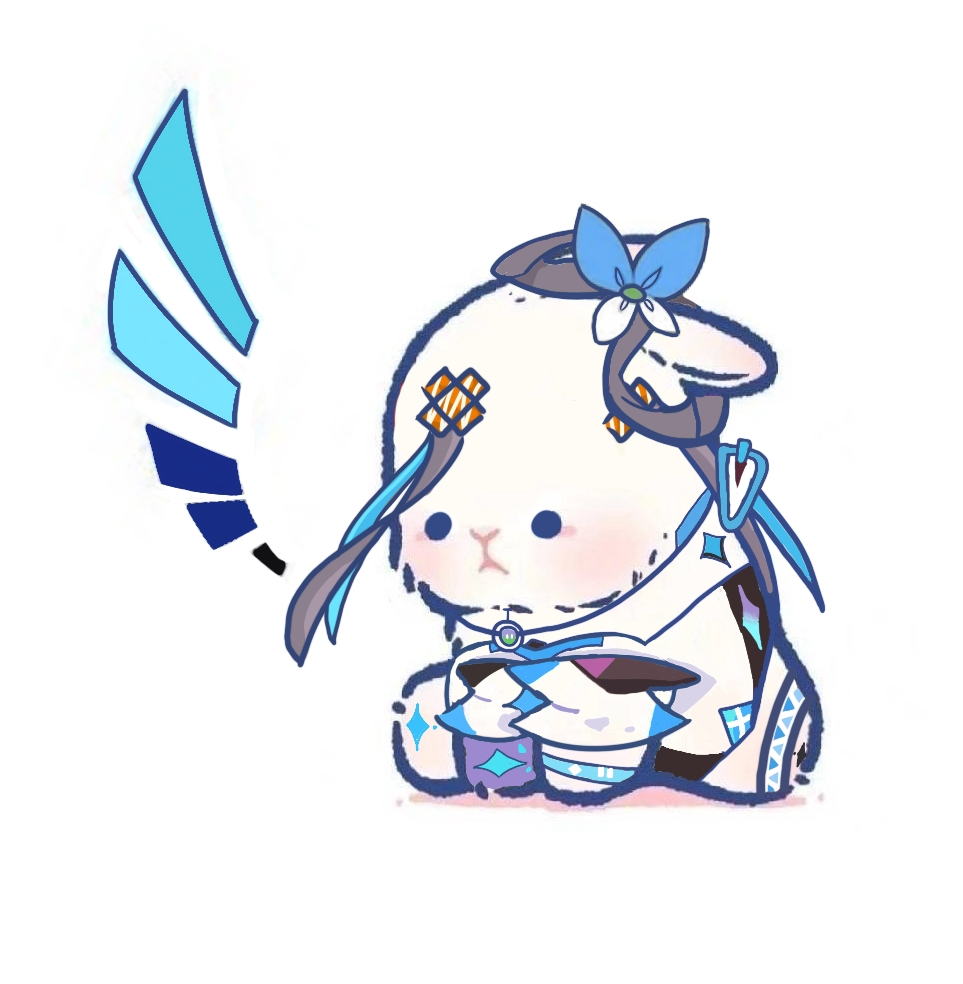
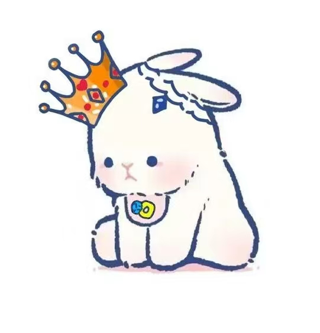
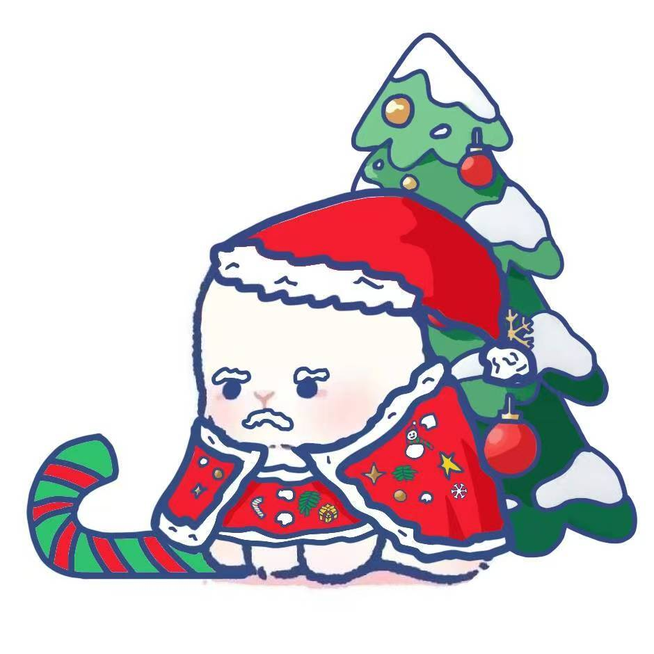
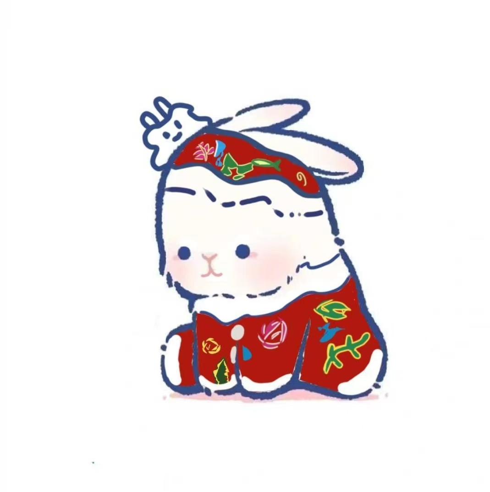
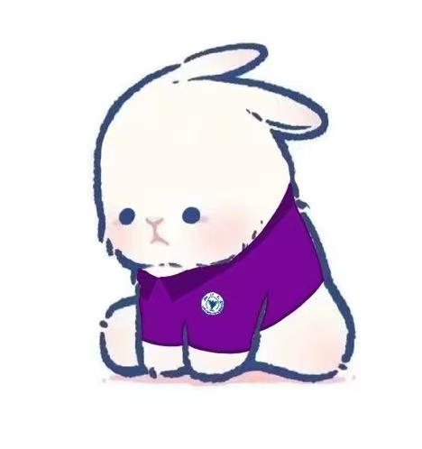

These drawings started with one simple shape: a round body, two long ears, and an expression somewhere between determination and mild confusion.

The usagi appeared as a 魔法少女 and as a prince. Some drawings show it simply trying to get through the day. Its face stayed mostly the same.

## Eleven usagi drawings

  <figure class="usagi-card usagi-card--feature">
    
    <figcaption>
      <strong>01 · The usagi</strong>
      Artist: 摸鱼阿八; image from the internet.
    </figcaption>
  </figure>

  <figure class="usagi-card">
    
    <figcaption>
      <strong>02 · Luotianyisagi</strong>
      很满意的一张！完成度很高呢！为了模仿天依贴上去两个毛也太好笑了吧~天依最有标志性的发型也被套在了两只兔耳朵上，可以看出来不是很情愿呢（摸摸）
    </figcaption>
  </figure>

  <figure class="usagi-card">
    
    <figcaption>
      <strong>03 · Ready</strong>
      高三的时候画的，虽然没用多长时间
    </figcaption>
  </figure>

  <figure class="usagi-card">
    
    <figcaption>
      <strong>04 · Linxueyingsagi</strong>
      小兔子穿上了CC98守护天使林雪樱的衣服！居然直接化身为了魔法使呢！旁边还有夏珺和南秋，分别是小兔兔和小猫猫，也超萌的！
    </figcaption>
  </figure>

  <figure class="usagi-card">
    
    <figcaption>
      <strong>05 · A very tiny prince</strong>
      给朋友画的，不过没被用就是了
      *2026年4月27日修改：原来在用
    </figcaption>
  </figure>

  <figure class="usagi-card">
    
    <figcaption>
      <strong>06 · The HAQI</strong>
      响应朋友的号召画了一只哈气的小兔子，话说小兔子哈气是什么样子的啊！还不知道呢
    </figcaption>
  </figure>

  <figure class="usagi-card">
    
    <figcaption>
      <strong>07 · MIKUsagi</strong>
      这个用了很长时间呢，喜欢手套上的胶皮质感（？）
    </figcaption>
  </figure>

  <figure class="usagi-card">
    
    <figcaption>
      <strong>08 · Neurosagi</strong>
      用的时间最长了，之后也还会用下去。小兔穿上了neuro的毛衣，耳朵上分别别了双子的发饰，也是完成度很高的一幅图呢~
    </figcaption>
  </figure>

  <figure class="usagi-card">
    
    <figcaption>
      <strong>09 · Santasagi</strong>
      一夜之间大家都开始戴圣诞帽了呢，那我家小兔也不能没有衣服穿！连忙画了一个。本来想画披肩＋小裙子的服装，结果看起来像披风＋肚兜（划掉）。被吐槽看起来像被绑起来了
    </figcaption>
  </figure>

  <figure class="usagi-card">
    
    <figcaption>
      <strong>10 · Festive red</strong>
      从兔年跨入了龙年呢！
    </figcaption>
  </figure>

  <figure class="usagi-card">
    
    <figcaption>
      <strong>11 · Usasgi in Yunfeng</strong>
      穿上了云峰紫的小兔。很有精气神
    </figcaption>
  </figure>

The drawings come from different times and do not form a matching set. The usagi changes outfits and moods in each one, but remains recognizably itself.
