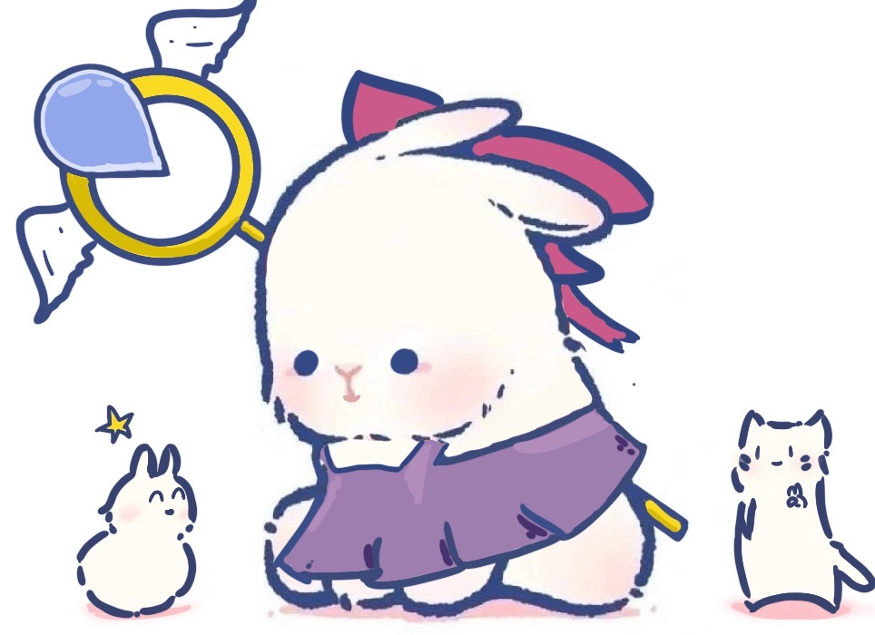
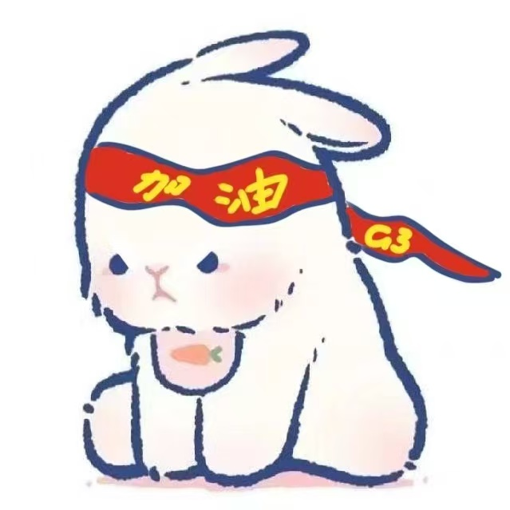
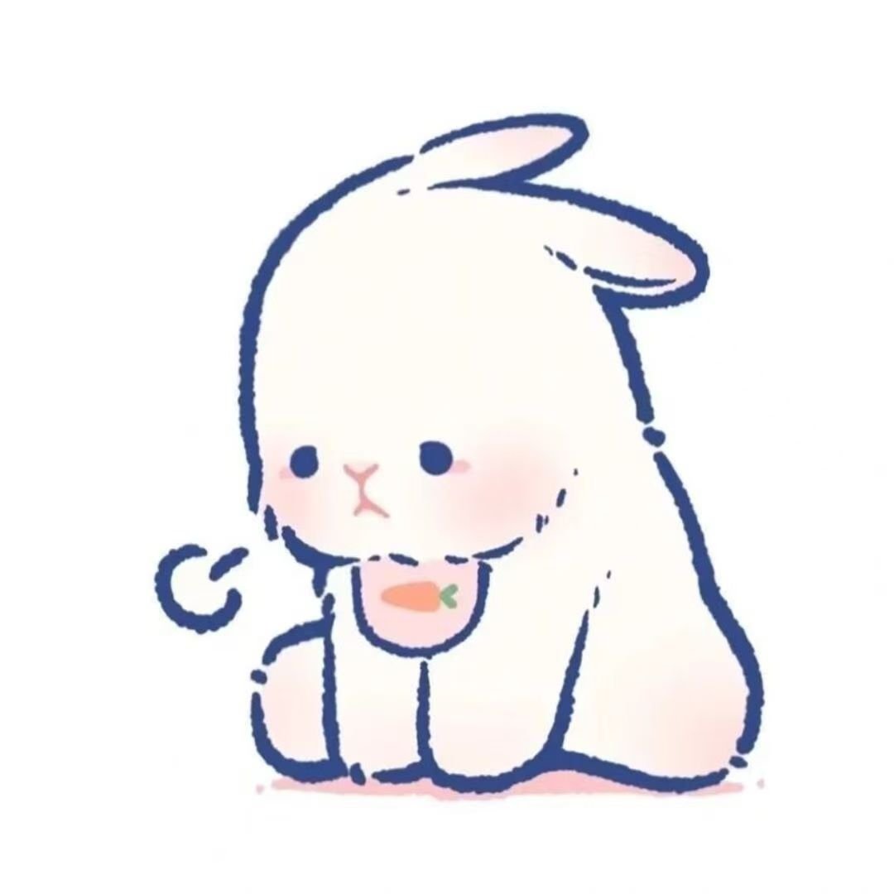
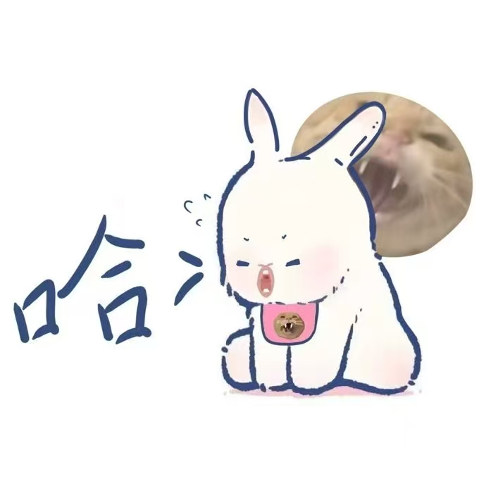
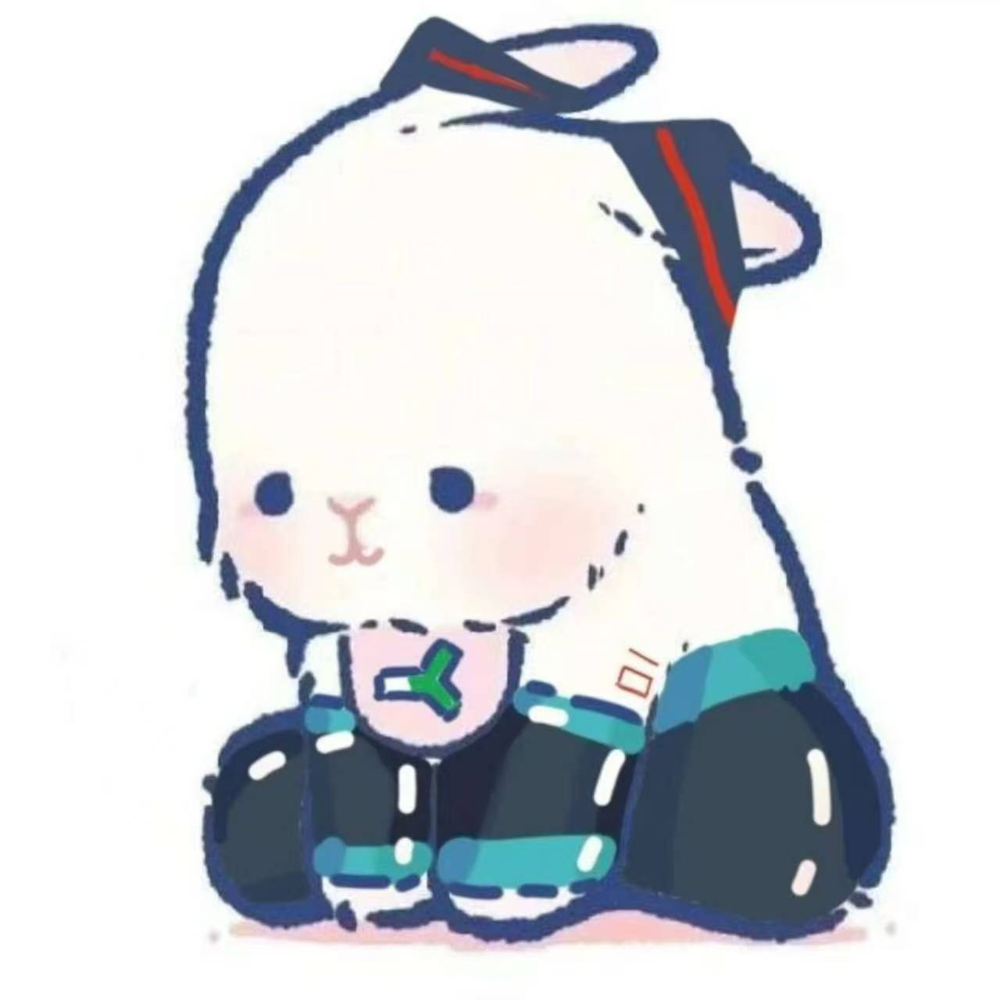
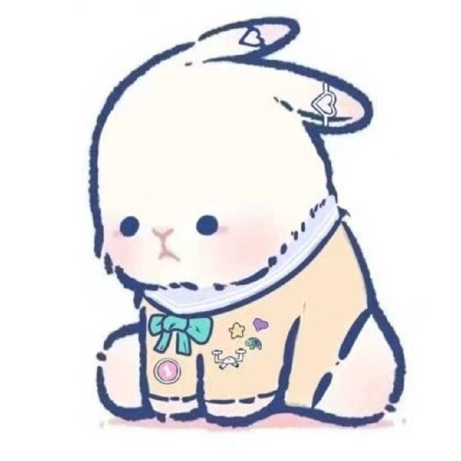

Some drawings begin with a big idea. These began with a simple shape: one round body, two long ears, and an expression somewhere between determination and mild confusion.

The little rabbit kept the same soft center while trying on different lives. Sometimes it was a witch, sometimes a prince, and sometimes it was simply doing its best to get through the day.

## A very small character with a lot of outfits

  <figure class="usagi-card usagi-card--feature">
    
    <figcaption>
      <strong>01 · The little witch</strong>
      Ready to cast a spell, accompanied by one tiny assistant and one deeply unimpressed familiar.
    </figcaption>
  </figure>

  <figure class="usagi-card">
    
    <figcaption>
      <strong>02 · Starry blue</strong>
      Dressed for an adventure that probably involves a very complicated map.
    </figcaption>
  </figure>

  <figure class="usagi-card">
    
    <figcaption>
      <strong>03 · Ready to try again</strong>
      A red headband, a carrot, and enough determination to finish the next chapter.
    </figcaption>
  </figure>

  <figure class="usagi-card">
    
    <figcaption>
      <strong>04 · The quiet pose</strong>
      Listening carefully, or perhaps thinking about absolutely nothing.
    </figcaption>
  </figure>

  <figure class="usagi-card">
    
    <figcaption>
      <strong>05 · A very tiny prince</strong>
      Royalty with excellent posture and no apparent interest in royal duties.
    </figcaption>
  </figure>

  <figure class="usagi-card">
    
    <figcaption>
      <strong>06 · The laugh</strong>
      Laughing at a joke that has already escaped the frame.
    </figcaption>
  </figure>

  <figure class="usagi-card">
    
    <figcaption>
      <strong>07 · Tracksuit mode</strong>
      Prepared for a productivity montage, or at least a short walk.
    </figcaption>
  </figure>

  <figure class="usagi-card">
    
    <figcaption>
      <strong>08 · Off to space</strong>
      An astronaut in spirit, but first—snacks.
    </figcaption>
  </figure>

  <figure class="usagi-card">
    
    <figcaption>
      <strong>09 · Santa bunny</strong>
      Making the yearly appearance with a suitably serious beard.
    </figcaption>
  </figure>

  <figure class="usagi-card">
    
    <figcaption>
      <strong>10 · Festive red</strong>
      Enough patterns to keep the entire holiday season busy.
    </figcaption>
  </figure>

  <figure class="usagi-card">
    
    <figcaption>
      <strong>11 · The comfortable form</strong>
      Purple jumper, soft expression, no further adventures required.
    </figcaption>
  </figure>

These drawings were not made as one perfect, tidy set. That is part of what makes them feel like a collection: the rabbit can change outfits, moods, and stories, but it still remains completely itself.
