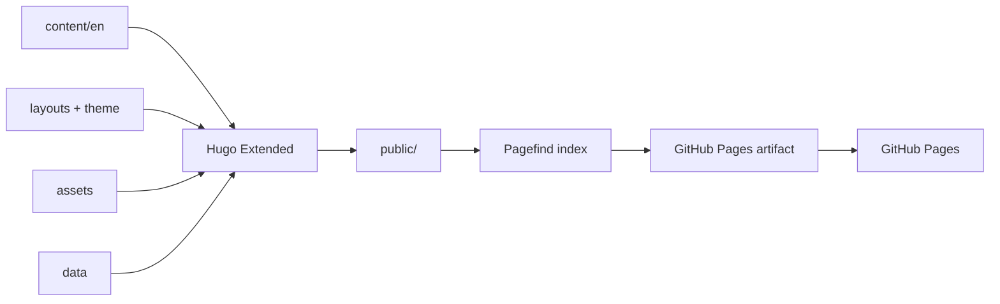

# Architecture

## Build pipeline

`static/` is copied without processing. Page resources and image transforms belong
inside page bundles, so Hugo can fingerprint, resize, or minify them during the
production build.

## Source boundaries

| Path | Responsibility |
| --- | --- |
| `content/en/` | Pages, page bundles, taxonomy metadata, and front matter |
| `layouts/` | Local shortcodes and overrides for `hugo-brewm` |
| `assets/` | JavaScript and CSS processed by Hugo |
| `static/` | Runtime assets that must keep stable public URLs |
| `data/` | Local snapshots consumed during the build |
| `themes/hugo-brewm/` | Pinned theme submodule |
| `scripts/` | Repository validation and maintenance automation |
| `docs/` | Architecture, operations, and historical records |

Local files under `layouts/`, `assets/`, and `content/en/` take precedence over the
theme. The theme submodule should be updated as a dedicated change.

## Quality gates

`npm run verify` is the release gate. It performs:

1. syntax checks for every local JavaScript and module file;
2. JSON validation for owned data and runtime assets;
3. repository integrity and version checks;
4. a production Hugo build;
5. Pagefind index generation;
6. an internal link audit of the generated HTML.

The CI workflow runs this gate for pull requests. The deployment workflow repeats
the relevant checks before uploading the Pages artifact.

## Content invariants

- Article front matter keeps `type: post`.
- Page-specific media stays in the article's page bundle.
- Shared runtime assets stay under `static/` with stable paths.
- Draft pages remain excluded from production output.
- Shortcodes follow the copy rules in `AGENTS.md`.
